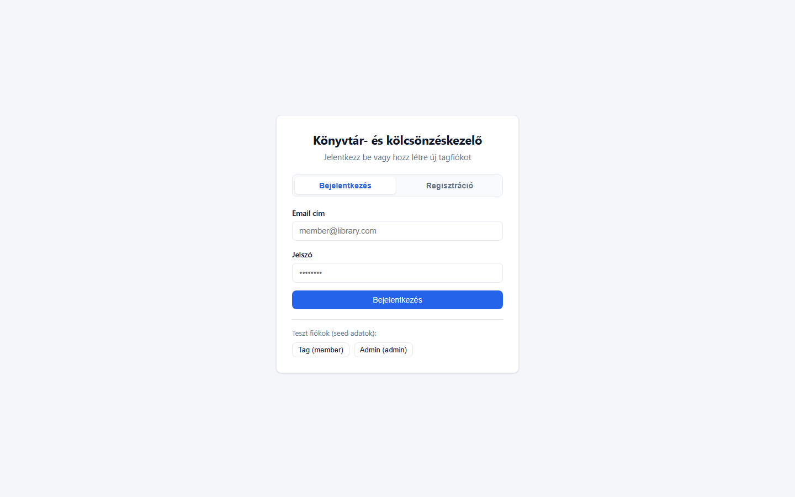
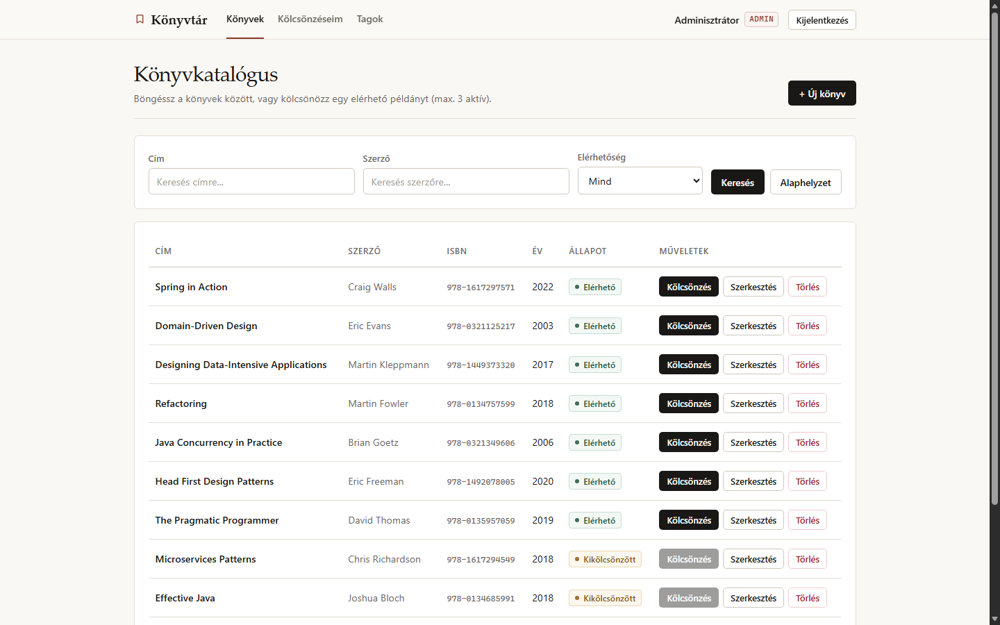
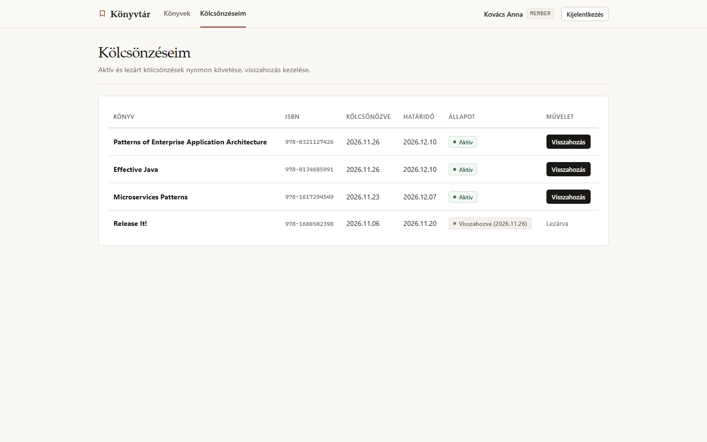
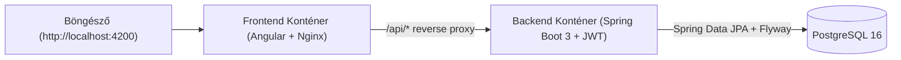

# Könyvtár- és kölcsönzéskezelő (Spring Boot + Angular)

[](https://github.com/Laczko77/konyvtar/actions/workflows/ci.yml)

Modern, konténerizált könyvtár- és kölcsönzéskezelő webalkalmazás **Java 21 / Spring Boot 3**, **PostgreSQL 16 + Flyway**, **Spring Security + JWT** és **Angular 22** alapokon — szigorú üzleti szabályokkal, DTO-alapú rétegzéssel és automatizált unit + Testcontainers integrációs tesztekkel.

---

## Tartalomjegyzék

- [Képernyőképek](#képernyőképek)
- [Architektúra áttekintése](#architektúra-áttekintése)
- [Technológiai stack](#technológiai-stack)
- [Indítás egy paranccsal (Docker Compose)](#indítás-egy-paranccsal-docker-compose)
- [Környezeti változók](#környezeti-változók)
- [Teszt belépési adatok (Flyway seed)](#teszt-belépési-adatok-flyway-seed)
- [API dokumentáció és fő végpontok](#api-dokumentáció-és-fő-végpontok)
- [Üzleti szabályok](#üzleti-szabályok)
- [Tesztek futtatása](#tesztek-futtatása)
- [Mit tanultam a projektből](#mit-tanultam-a-projektből)
- [Továbbfejlesztési lehetőségek](#továbbfejlesztési-lehetőségek)

---

## Képernyőképek

### Bejelentkezés és regisztráció


### Könyvkatalógus (szűrés, kölcsönzés és Admin CRUD)


### Kölcsönzéseim (késedelmi jelzés és visszahozás)


---

## Architektúra áttekintése



### Fő funkciók
- **Hitelesítés és szerepkörök (`ADMIN` / `MEMBER`):** Regisztráció, JWT-alapú stateless belépés, szerepkörhöz kötött API és UI jogosultságok.
- **Könyvkatalógus:** Keresés cím és szerző szerint, elérhetőség szűrés, szerveroldali lapozás (`Pageable`), valamint `ADMIN` CRUD műveletek (létrehozás, szerkesztés, törlés).
- **Kölcsönzéskezelés:** Könyv kölcsönzése és visszavétele, késedelmes kölcsönzések jelölése (`overdue`), valamint `ADMIN` nézet az összes kölcsönzésre és tagra.

---

## Technológiai stack

| Réteg | Technológiák |
| --- | --- |
| **Backend** | Java 21, Spring Boot 3.4.3, Spring Web, Spring Data JPA (Hibernate), Spring Validation |
| **Adatbázis & Migráció** | PostgreSQL 16, Flyway (`ddl-auto: validate`) |
| **Biztonság** | Spring Security (stateless), JWT (`jjwt` 0.12.6, HMAC-SHA256), BCrypt |
| **API Dokumentáció** | Springdoc OpenAPI / Swagger UI (`2.8.5`) |
| **Tesztelés (Backend)** | JUnit 5, Mockito, MockMvc, Testcontainers (PostgreSQL 16) |
| **Frontend** | Angular 22 (standalone komponensek, Router, HttpClient, funkcionális interceptor és guardok), Vitest |
| **DevOps & CI/CD** | Docker (multi-stage build), Nginx reverse proxy, Docker Compose, GitHub Actions |

---

## Indítás egy paranccsal (Docker Compose)

**Előfeltétel:** Docker és Docker Compose telepítve van a gépen.

1. (Opcionális) Másold le a környezeti változók sablonját:
   ```bash
   cp .env.example .env
   ```
2. Indítsd el a teljes rendszert (`db` + `api` + `frontend`):
   ```bash
   docker compose up --build
   ```

Elérhető szolgáltatások indulás után:
- **Frontend (Angular + Nginx):** http://localhost:4200
- **Backend REST API:** http://localhost:8080
- **Swagger UI:** http://localhost:8080/swagger-ui.html

Leállításhoz és a tesztadatbázis teljes alaphelyzetbe állításához:
```bash
docker compose down -v
```

---

## Környezeti változók

A [.env.example](./.env.example) tartalmazza az összes konfigurálható paramétert (érzékeny adatok és titkos kulcsok nélkül a repóban):

| Változó | Alapértelmezett érték (`docker-compose.yml` / `application.yml`) | Leírás |
| --- | --- | --- |
| `POSTGRES_DB` | `library` | PostgreSQL adatbázis neve |
| `POSTGRES_USER` | `app` | Adatbázis felhasználó |
| `POSTGRES_PASSWORD` | `app` | Adatbázis jelszó |
| `JWT_SECRET` | `change-me-in-production-min-256-bit-secret-key` | Min. 256 bites titkos kulcs JWT aláíráshoz |
| `JWT_EXPIRATION_MS` | `86400000` | Token lejárati idő ezredmásodpercben (24 óra) |

---

## Teszt belépési adatok (Flyway seed)

Az alkalmazás első indulásakor a [V2__seed_data.sql](./backend/src/main/resources/db/migration/V2__seed_data.sql) automatikusan betölt 3 felhasználót, 12 könyvet és 3 minta kölcsönzést (köztük egy lejárt határidejű, késedelmes kölcsönzést is):

| Szerepkör | Email | Jelszó | Megjegyzés |
| --- | --- | --- | --- |
| `ADMIN` | `admin@library.com` | `Admin123!` | Teljes CRUD, összes kölcsönzés és tagok listája |
| `MEMBER` | `member@library.com` | `Member123!` | Kovács Anna — 1 aktív és 1 lejárt (késedelmes) kölcsönzéssel indul |
| `MEMBER` | `member2@library.com` | `Member123!` | Nagy Péter — 1 lezárt (visszahozott) kölcsönzéssel indul |

---

## API dokumentáció és fő végpontok

A teljes interaktív API dokumentáció elérhető a **/swagger-ui.html** útvonalon (beépített JWT Bearer hitelesítéssel — a `/api/auth/login` válaszából kapott `token` az `Authorize` gombbal megadható).

| Metódus | Végpont | Jogosultság | Leírás |
| --- | --- | --- | --- |
| `POST` | `/api/auth/register` | Nyilvános | Új `MEMBER` felhasználó regisztrálása |
| `POST` | `/api/auth/login` | Nyilvános | Bejelentkezés és JWT token igénylése |
| `GET` | `/api/books` | Hitelesített | Könyvek listázása szűréssel (`title`, `author`, `available`) és lapozással (`page`, `size`) |
| `GET` | `/api/books/{id}` | Hitelesített | Könyv adatainak lekérdezése |
| `POST` | `/api/books` | `ADMIN` | Új könyv felvitele (ISBN egyediség ellenőrzéssel) |
| `PUT` | `/api/books/{id}` | `ADMIN` | Könyv adatainak módosítása |
| `DELETE` | `/api/books/{id}` | `ADMIN` | Könyv törlése |
| `GET` | `/api/members` | `ADMIN` | Összes tag listázása |
| `GET` | `/api/members/me` | Hitelesített | Bejelentkezett felhasználó adatai |
| `POST` | `/api/loans` | Hitelesített | Könyv kölcsönzése (`{ "bookId": 1 }`) |
| `PATCH` | `/api/loans/{id}/return` | Hitelesített | Kölcsönzés visszahozása (`ADMIN` bármelyiket, `MEMBER` csak a sajátját) |
| `GET` | `/api/loans/my` | Hitelesített | Saját kölcsönzések listázása |
| `GET` | `/api/loans` | `ADMIN` | Összes kölcsönzés listázása (opcionális `overdue=true`/`false` szűrővel) |

---

## Üzleti szabályok

- **Max. 3 aktív kölcsönzés:** Egy tagnak egyszerre legfeljebb 3 aktív (`returned_at IS NULL`) kölcsönzése lehet; a 4. kísérlet `409 Conflict` (`LoanLimitExceededException`) hibát ad.
- **Dupla kiadás tilalma:** Kikölcsönzött könyv (`available == false` vagy aktív `Loan` rekord) nem kölcsönözhető ki újra (`409 Conflict` / `BookNotAvailableException`).
- **14 napos határidő és késedelem:** Új kölcsönzéskor `due_date = borrowed_at + 14 nap`. A `LoanResponse` számított `overdue` mezője `true`, ha `returnedAt == null` és `now > dueDate`.
- **Visszavétel jogosultság:** `MEMBER` csak saját kölcsönzést hozhat vissza (`403 Forbidden` más kölcsönzésénél), már visszahozott kölcsönzés nem vehető vissza újra (`409 Conflict` / `LoanAlreadyReturnedException`).

---

## Tesztek futtatása

### Backend (Unit + Testcontainers PostgreSQL integrációs tesztek)
*(A Testcontainers integrációs tesztek futtatásához működő Docker daemon szükséges.)*

```bash
cd backend
mvn -B verify
```

Csak a Mockito-alapú unit tesztek futtatása (Docker nélkül):
```bash
cd backend
mvn -B test -Dtest="*ServiceTest,JwtServiceTest"
```

### Frontend (Unit tesztek és production build)
```bash
cd frontend
npm test -- --watch=false
npm run build
```

---

## Mit tanultam a projektből

1. **Miért nem adok vissza JPA entitást a controllerből:**
   Korábbi gyakorlóprojektjeimben kényelmesnek tűnt közvetlenül az entitásokat visszaadni a REST végpontokból, itt viszont tudatosan külön Java `record` DTO-kat használtam minden kéréshez és válaszhoz. Így biztosan nem szivárog ki érzékeny adat (például a jelszó hash), nem törik el a szerializáció a `LAZY` kapcsolatok miatt, és az olyan számított mezők, mint a késedelmi jelzés (`overdue`), tisztán elférnek a `LoanResponse`-ban adatbázis-oszlop nélkül is.

2. **`open-in-view: false` és az N+1 probléma kezelése:**
   Direkt kikapcsoltam a Spring Boot alapértelmezett `spring.jpa.open-in-view` beállítását, a `Loan` entitáson pedig `LAZY` kapcsolatokat használtam. Így fejlesztés közben azonnal látszott, ha egy végpont a tranzakción kívül próbált volna adatot betölteni, vagy felesleges extra lekérdezéseket generált volna. A `LoanRepository`-ban `@EntityGraph`-fal oldottam meg, hogy a listázások egyetlen `JOIN` lekérdezéssel megkapják a könyv- és felhasználói adatokat is.

3. **Valódi PostgreSQL tesztelés H2 helyett (`Flyway` + `Testcontainers`):**
   A `ddl-auto: update` kényelmes tanuláshoz, de hamar rájöttem, hogy könnyen elfedi a hibákat. Itt `ddl-auto: validate` fut Flyway migrációkkal, az integrációs tesztek pedig Testcontainers-szel indított valódi PostgreSQL 16-on mennek végig. Ha egy oszloptípus vagy megszorítás nem stimmel az entitás és az SQL között, már a tesztek elhasalnak. (Érdekes hibakeresés volt, amikor az újabb Docker Engine 29 elutasította a Testcontainers alapértelmezett régi API hívásait — végül a `docker-java.properties` beállításával sikerült feloldani.)

4. **Az üzleti logika helye a backendben (`@Transactional` és `@Version`):**
   A frontenden letiltott „Kölcsönzés” gomb csak kényelmi funkció; ha két kérés egyszerre érkezik ugyanarra a könyvre, a backendnek kell védenie az állapotot. A 3 könyves limitet és az elérhetőséget tranzakción belül ellenőrzöm, a `Book` entitáson lévő `@Version` optimista zárolás pedig megfogja a párhuzamos módosításokat, amiből a `GlobalExceptionHandler` egységes `409 Conflict` választ ad vissza az Angular felületnek.

5. **Jogosultságkezelés az UI-n túl:**
   Az Angular oldalon lévő route guardok és elrejtett admin gombok önmagukban még nem jelentenek biztonságot. A valódi védelmet a stateless JWT filter és a backend `@PreAuthorize` szabályai adják — ezért írtam külön integrációs teszteket arra is, hogy egy sima `MEMBER` tokennel tényleg `403 Forbidden`-t kapjon az admin végpontokra, token nélkül pedig `401 Unauthorized`-ot.

---

## Továbbfejlesztési lehetőségek

Az MVP lezárása és a kód átvizsgálása után az alábbi irányokban érdemes továbbvinni a projektet:

- **Párhuzamos kölcsönzési limit védelme felhasználói szinten:** A `Book` entitáson lévő `@Version` megfogja, ha ketten ugyanazt a könyvet akarják egyszerre kikölcsönözni. Ha viszont ugyanaz a tag pontosan egyszerre két *különböző* könyvet próbál kivenni a 3 könyves limit közelében, érdemes pesszimista zárolást tenni a felhasználói sorra a kölcsönzés idejére.
- **Könyvek archiválása (soft delete) végleges törlés helyett:** A már kölcsönzési előzménnyel rendelkező könyveket a backend jelenleg tudatosan védi a törléstől (`409 Conflict` / `BookHasLoanHistoryException`), hogy ne vesszen el a történeti adat. Egy `archived` mezővel az ilyen példányok elrejthetők lennének az aktív katalógusból adatvesztés nélkül.
- **Kölcsönzések lapozása és szűrése:** A könyvkatalógushoz hasonlóan a `/api/loans` és `/api/loans/my` végpontokra is érdemes `Pageable` lapozást, valamint tagra vagy dátumra való szűrést tenni nagyobb adatmennyiség esetére.
- **Frontend komponens-tesztek és élő demó deploy:** A projektben jelenleg a backend oldali unit és Testcontainers integrációs tesztek adják a fő tesztlefedettséget. Következő lépésként érdemes az Angular oldalakhoz is több egységtesztet írni, illetve a CI workflow-t kiegészíteni egy automata deploy lépéssel (CD).
